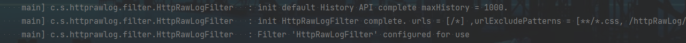
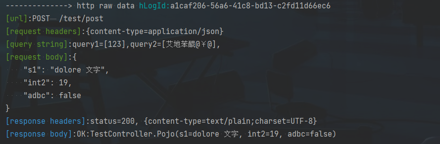
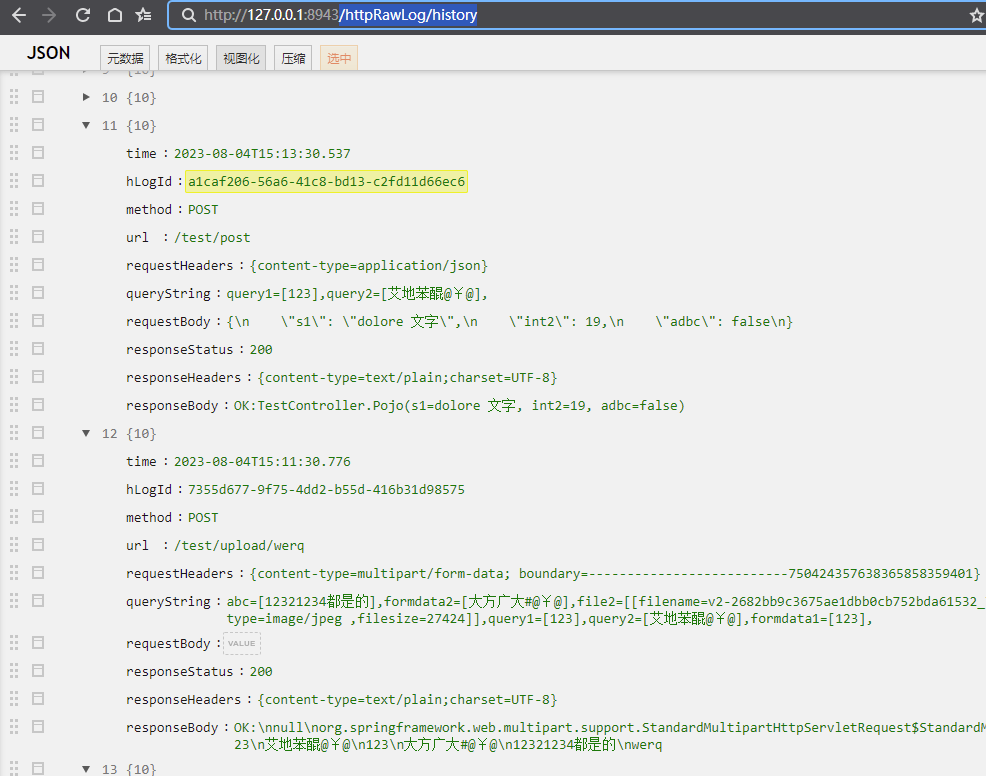

# http-raw-log

### 简介

> 打印 http 请求原始报文日志
>

> 已发布到 Maven Central：[`com.skycong:http-raw-log:1.1.0`](https://central.sonatype.com/artifact/com.skycong/http-raw-log/1.1.0)

### 快速接入

- #### 1 引入依赖坐标

- ```xml
  <dependency>
    <groupId>com.skycong</groupId>
    <artifactId>http-raw-log</artifactId>
    <version>1.1.0</version>
  </dependency>
  ```

> 兼容性：`1.x` 面向 Spring Boot 3.x / Java 17（`jakarta.servlet`）；Spring Boot 2.x / Java 8 请使用 `0.9.x`。
>
> 构建发布、从 0.9.x 升级、运行限制和 FAQ 见 [项目维护指南](doc/项目维护指南.md)。
  
- #### 2 配置log level 为 debug，在**application.properties** 中配置如下一行

- ```properties
  # 由于log使用的是debug级别，使用时需要配置日志级别
  logging.level.com.skycong.httprawlog=debug
  ```
  
- #### 3 启动服务，控制台输出以下信息代表接入成功

- []()

- #### 4 此时调用接口会发现控制台输出如下日志

- []()

- #### 5 至此完成

  

---

### 其他说明

- #### 完整的配置参数

- ```properties
  # 由于log使用的是debug级别，使用时需要配置日志级别
  logging.level.com.skycong.httprawlog=debug
  # 是否开启 http-raw-log（关闭时不再注册 filter 及 /httpRawLog/* 调试接口），默认 true
  com.skycong.http-raw.log.open=true
  # 拦截打印的url正则，参考 Filter UrlPatterns 格式，多个URL时使用‘,’ 分隔，默认 /*
  com.skycong.http-raw.log.urls=/url1/*,/test/*
  # 排除的url 路径规则：org.springframework.util.AntPathMatcher
  com.skycong.http-raw.log.url.exclude=/test/**,*.js,*.css
  # 需要打印http-raw-log的请求头key，多个使用‘,’ 分隔，默认 content-type
  # 注意：cookie/authorization 等敏感头一旦加入会明文记录，当前版本没有脱敏
  com.skycong.http-raw.log.headers=content-type,host,accept-language,referer,user-agent
  # form-data 是否需要使用utf-8重新编码（0: 自动判断，1：始终需要编码，2：始终不编码）默认 0.
  com.skycong.http-raw.log.form-data.encode=0
  # 保留最近的请求历史记录条数，示例 100；不配置时默认 0（不存储历史，只输出控制台日志）
  # 访问地址：/httpRawLog/history，如有权限拦截请添加白名单
  com.skycong.http-raw.log.history=100
  # 历史记录总字节数上限，默认 4MB；与 history 条数上限同时生效，超出淘汰最旧记录
  com.skycong.http-raw.log.history.maxTotalBytes=4194304
  # 历史记录中单个 queryString/requestBody/responseBody 的最大字节数，默认 32KB，按 UTF-8 安全截断
  com.skycong.http-raw.log.history.maxBodyBytes=32768
  # 控制台打印的 response body 最大字符数，默认 203；小于等于 0 表示不截断，1~3 直接截断
  com.skycong.http-raw.log.history.maxChars=203
  # 控制台 ANSI 颜色，默认跟随 System.console()（重定向到文件/非 TTY 自动关闭）
  com.skycong.http-raw.log.console.colors=true
  # 请求体日志上限，默认 64KB；有 Content-Length 且超过上限/二进制/压缩时不再包装；form/multipart 未知长度跳过；普通 chunked 有界预读并回放
  com.skycong.http-raw.log.maxRequestBodyBytes=65536
  # 响应体日志上限，默认 64KB；仅影响日志，客户端始终收到完整响应
  com.skycong.http-raw.log.maxResponseLogBytes=65536
  # 是否开启请求耗时统计，默认开启.访问地址：/httpRawLog/statistics?type=total&sort=desc，如有权限拦截请添加白名单
  com.skycong.http-raw.log.statistics=true
  ```

- #### 访问地址 **/httpRawLog/history** 可查看最近的历史记录（需配置 `history > 0` 才有数据；`history=0` 时接口存在但返回空数组，每页 50 条，最多 20 页）

- > 可使用hLogId 查询记录：/httpRawLog/history?hLogId=a1caf206-56a6-41c8-bd13-c2fd11d66ec6 
  >
  > 单条详情（列表中的 body 已按 `history.maxBodyBytes` 截断）：/httpRawLog/history/a1caf206-56a6-41c8-bd13-c2fd11d66ec6

- 

  

- #### 重写 **HistoryRecord** 可自定义日志处理逻辑

- ```java
  import com.skycong.httprawlog.api.History;
  import com.skycong.httprawlog.api.HistoryRecord;
  import org.springframework.stereotype.Component;
  
  /**
   * 重写 HistoryRecord 后，默认的 /httpRawLog/history 接口将失效
   */
  @Component
  public class HistoryRecord2 implements HistoryRecord {
      @Override
      public void record(History history) {
          System.out.println(history);
      }
  }
  ```

- #### hLogId 说明

- > 1，客户端在请求头中写入 hLogId ，如果请求头中没有 hLogId ，服务端自动生成并写入
  >
  > 2， 服务端返回响应头中回显 hLogId ，用来追踪记录每一次请求
  >
  > 3，使用场景：调试接口时，客户端打印响应头中的 hLogId ，用来标记每一次请求出入参数

- #### 两种历史记录模式

- > `history=0`（默认）：只输出控制台日志，`/httpRawLog/history` 仍存在但返回空数组；
  >
  > `history>0`：控制台 + 内存历史，受 `history.maxTotalBytes` 和 `history.maxBodyBytes` 双重限制。
  >
  > 自定义 `HistoryRecord` bean 后，默认的 `/httpRawLog/history` 不再创建，由你的实现决定如何暴露。
  >
  > 如需替换 filter，请使用 bean 名 `httpRawLogFilterRegistration`（或直接提供同类型 bean），避免注册两个 filter。

---

### 构建与发布

```bash
# 本地编译 + 全量测试（JDK 17）
./gradlew :test:test :core:build

# 只安装到本地 Maven 仓库，不需要 GPG
./gradlew :core:publishToMavenLocal

# 正式发布：生成签名产物并打包成 Maven Central 上传 zip
# 本机推荐先在本机 ~/.gradle/gradle.properties 配置
# signing.keyId / signing.password / signing.secretKeyRingFile
./gradlew :core:publishAndZip

# CI 或临时环境可用 in-memory key
SIGNING_KEY="$(cat private.pgp)" SIGNING_PASSWORD='***' ./gradlew :core:publishAndZip
```

- 本机签名使用 Gradle `signing` 插件的标准属性 `signing.keyId`/`signing.password`/`signing.secretKeyRingFile`，配置一次即可；CI 继续使用 `SIGNING_KEY`/`SIGNING_PASSWORD`，也可用 `-PsigningKey/-PsigningPassword`。
- `publishAndZip` 的产物位于 `core/build/http-raw-log-<version>.zip`，正常会生成 5 个 `.asc`；手动发布时上传到 <https://central.sonatype.com/publish>。
- 没有配置签名密钥时，`signing` 会被跳过，`publishToMavenLocal` 仍可正常使用；没有 `.asc` 的 zip 不能提交到 Central。
- CI 配置：GitHub Actions 见 `.github/workflows/ci.yml`（JDK 17 + Gradle Wrapper）；Gitee Go 见 `.workflow/MasterPipeline.yml`。
- 完整的 GPG 密钥准备、Central Portal 上传步骤和 CI 说明见 [项目维护指南 §4](doc/项目维护指南.md)。

#### 验证签名

发布公钥完整指纹：

```text
5AFD 16C6 8829 71E6 F606 CF00 2F53 3D5A 0FA3 14E7
```

Key ID：`2F533D5A0FA314E7`

```bash
# 1. 获取公钥
gpg --keyserver keyserver.ubuntu.com --recv-keys 2F533D5A0FA314E7

# 2. 核对完整指纹
gpg --fingerprint 2F533D5A0FA314E7

# 3. 下载 jar 和签名
base=https://repo1.maven.org/maven2/com/skycong/http-raw-log/1.1.0
curl -LO "$base/http-raw-log-1.1.0.jar"
curl -LO "$base/http-raw-log-1.1.0.jar.asc"

# 4. 验签
gpg --verify http-raw-log-1.1.0.jar.asc http-raw-log-1.1.0.jar
```

看到 `Good signature` 且指纹与上面一致即通过。`[unknown]` 只表示本地尚未信任该公钥，不代表签名无效；身份确认以完整指纹和 Central 命名空间为准。pom、sources、javadoc、module 的 `.asc` 同理。

#### 自动发布（GitHub Actions）

推送 `v*` tag 后，[release.yml](.github/workflows/release.yml) 会：

1. 校验 tag 与 `gradle.properties` 版本一致（SNAPSHOT 直接拒绝）；
2. 跑全量测试，生成带 5 个 `.asc` 的 zip；
3. 调用 Central Portal Publisher API 上传；
4. 轮询部署状态，校验通过后按模式继续。

仓库 Secrets：

| Secret | 用途 |
|---|---|
| `SIGNING_KEY` / `SIGNING_PASSWORD` | GPG 私钥 armored 文本 / 口令 |
| `CENTRAL_USERNAME` / `CENTRAL_PASSWORD` | Central Portal User Token 的用户名 / 密码 |

可选仓库变量 `CENTRAL_PUBLISHING_TYPE`：

| 值 | 行为 |
|---|---|
| `USER_MANAGED`（默认） | 校验通过后停在 `VALIDATED`，到 Central 页面点 **Publish** |
| `AUTOMATIC` | 校验通过后自动发布，**版本不可撤销** |

User Token 在 <https://central.sonatype.com/account> 生成。首次建议用 `USER_MANAGED`，确认无误后再切 `AUTOMATIC`。

---

### 更新日志

#### v1.1.0

> 2026-11-11 已发布到 Maven Central。

- **响应 tee + 大小可控**：`ResponseWrapper` 只旁路复制日志，客户端始终收到完整响应；日志上限默认 64KB（`maxResponseLogBytes` 可配），不再固定 4MB
- **无 charset 的 JSON 响应不再乱码**：字符集选择优先取 `Content-Type` 的 `charset=`，JSON/XML 缺省按 UTF-8；Tomcat 默认的 ISO-8859-1 只在严格 UTF-8 校验失败时使用，请求体日志和响应体日志共用同一套规则。业务侧 `getReader()` 不做该启发式，保持 `charset=`/容器声明编码（JSON/XML 缺省 UTF-8），避免日志组件改变业务读取语义
- **二进制/附件/SSE 跳过捕获**：按 `Content-Type`、`Content-Disposition: attachment`、`Content-Encoding` 判断，文件下载、图片/音视频、gzip、`text/event-stream` 不再白拷日志缓冲，只记录 content-type 与总字节数
- **请求体防 OOM**：新增 `maxRequestBodyBytes`（默认 64KB）。仅 POST/PUT/PATCH/DELETE 可能带 body；GET/HEAD 直接记录空 body，不再出现 `[request body skipped: unknown content-length]`。有 `Content-Length` 且超过上限、二进制、压缩时不再包装请求，业务读取原始流，日志只写 `[request body skipped: ...]`；form/multipart 未知长度也跳过。2GB 的 Content-Length 也不会触发大数组分配
- **form-urlencoded 原始 body**：先缓存原始字节，再自行解析参数，修复真实容器下 body 已被消费、日志只剩参数的问题；参数解析和日志解码共用同一套 charset，GBK 表单不再出现“`@RequestParam` 正确、日志乱码”；没有 `=` 的 flag 参数按 Servlet 语义返回空串
- **chunked 请求体可捕获**：没有 `Content-Length` 时预读 `maxRequestBodyBytes + 1` 字节，缓冲从 8KB 按需扩容，不会按配置上限预分配；未超限完整记录，超限只记录前缀，剩余字节通过 `SequenceInputStream` 回放给业务，业务仍拿到完整 body。`getInputStream()` 返回同一个流实例，与容器原始流一样只能消费一次；form/multipart 因需要完整 body 解析，仍保持跳过
- **sendError 摘要**：`sendError` 会清空响应缓冲，1.1.0 起同时记录 `[sendError 404: message]`，错误请求不再出现空 responseBody；容器渲染的错误页正文仍不捕获
- **响应头补全**：Tomcat 通过 `setContentType` 设置的媒体类型不在 `getHeader("content-type")` 时，回退 `getContentType()`，日志不再丢失 content-type
- **异步/SSE 正确记录**：Servlet 异步请求通过 `AsyncListener` 在真正完成时记录一次；`onComplete`/`onError`/`onTimeout` 去重，SSE 不缓存 body
- **异常路径状态修正**：filter 捕获 `Throwable` 后仍记录日志，状态按 500 处理，responseBody 追加最内层异常类与消息摘要，然后原样抛出
- **历史内存可控**：新增 `history.maxTotalBytes`（默认 4MB，按条数 + UTF-8 字节数双淘汰，CJK 不再被低估）和 `history.maxBodyBytes`（默认 32KB，UTF-8 安全截断）；新增 `/httpRawLog/history/{hLogId}` 单条详情接口
- **请求体恢复完整**：修复 0.9.16 中“业务 body 被截断”的回归；小请求体完整回放，只有日志字符串会截断
- **Writer 修复**：`getWriter()` 返回单实例并在请求结束时 flush，修复视图渲染/大响应丢内容；`getWriter()` 与 `getOutputStream()` 按 Servlet 规范互斥
- **去掉静态状态与线程泄漏**：`HistoryStore`、`StatisticsApi`、`FileAppender` 改为 Spring 单例 bean，统计/文件监听线程改为 daemon 并由容器销毁；`FileAppender` 修复未配置 txId 函数时的 NPE 和逐行全量扫描
- **自动装配更安全**：使用 `@AutoConfiguration` + `@ConditionalOnWebApplication(SERVLET)` + `@ConditionalOnClass`；开关/统计改用条件注解与容错解析，配置写错不会导致宿主应用启动失败；bean 名改为 `httpRawLogFilterRegistration`，避免与业务 bean 冲突
- **统计防膨胀**：统计 URI 将数字/UUID/长十六进制路径参数归一化为 `{id}`，并限制最多 1000 个 URI key
- **构建/IDE 友好**：`core` jar 增加 `Automatic-Module-Name: com.skycong.httprawlog`；新增配置元数据一致性测试，检查 key 与 description，避免手写 metadata 与 `Constant`/实际行为漂移
- **控制台颜色可关**：默认跟随 `System.console()`，重定向到文件/非 TTY 时自动关闭，也可用 `com.skycong.http-raw.log.console.colors=false` 显式关闭
- **POM 补充依赖**：`spring-boot-starter-web` 以 `provided` + `optional` 写入 POM，解决“零依赖 jar”在 IDE/编译期缺类的问题
- **发布工程**：版本统一由 `gradle.properties` 控制；无签名密钥时跳过 signing，`publishToMavenLocal` 可直接运行；恢复 javadoc jar；CI 改为 JDK 17 + Gradle Wrapper
- **升级提示（不兼容）**：`HistoryApi.HISTORIES` 静态集合与 `StatisticsApi.statistics(...)` 静态方法已移除；自定义记录器/统计代码请改为注入 `HistoryStore`、`StatisticsApi` bean
- 移除未使用的 `InMemoryAppender`（同时去掉对 logback 的隐式编译依赖）

#### v0.9.16

- 新增 RequestWrapper 请求体日志截断：日志字符串上限 4MB，超过部分标记 `[request body truncated]`，避免大请求体导致日志字符串 OOM
- 业务 body 保持完整：截断仅作用于日志输出，回放给 Controller 的请求体仍完整，不影响业务（注：0.9.16 实现实际仍会截断业务 body，已在 1.1.0 修复）
- 性能优先：请求体单次读取缓存，无额外 drain / 二次遍历开销
- 新增 test 模块集成测试：`RequestBodyIntegrationTest`（MockMvc 全流程，验证大 body 日志截断但业务 body 完整、小 body 完整无截断）与 `RequestWrapperBodyTest`（组件测试，覆盖 4MB 边界、form-urlencoded 解码、空 body），共 8 个用例
- 构建配置：test 模块启用 `useJUnitPlatform()` 支持 JUnit5；强制产出 Java8 字节码以兼容 Spring Boot 2.3.x 的 ASM 组件扫描
- RequestWrapper 代码审查优化：`isFinished` 语义修正、`getParameter` 三元简化、`packageParameterMapAll` 改用 `entrySet` 遍历、修正构造器 javadoc

#### v0.9.15

- 修复 StatisticsApi 竞态条件，字段添加 volatile，使用 compute() 原子操作
- 修复 History.java 中无效的 WeakReference，改为普通 ArrayList
- 替换 RequestWrapper 中的 e.printStackTrace() 为 SLF4J 日志
- 提取 HttpRawLogFilter 中 AntPathMatcher 为类字段复用，避免每次请求创建新实例
- 优化 ResponseWrapper 添加 1MB 大小限制防止 OOM
- 替换 FormRequestWrapper 中无效的 assert 为异常检查
- 修复 StatisticsApi 中不必要的 parallelStream
- 修复 HistoryApi 中双重 removeLast() 逻辑错误
- 优化 Constant 中匿名内部类为 Collections.unmodifiableSet
- 修复 FileAppender stop() 方法一致性，改为 static
- 移除 HttpRawLogFilter 中 String.getBytes() 多余转换
- 简化 HistoryApi 分页逻辑
- 修复 Constant 中 STRING0/STRING3/STRING4 命名为 AMPERSAND/SEMICOLON/PATH_ALL