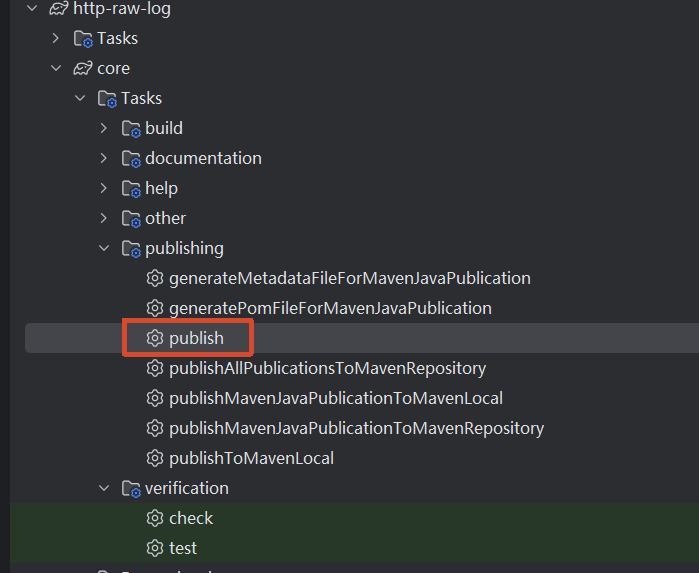
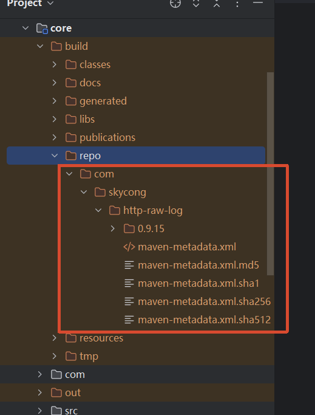
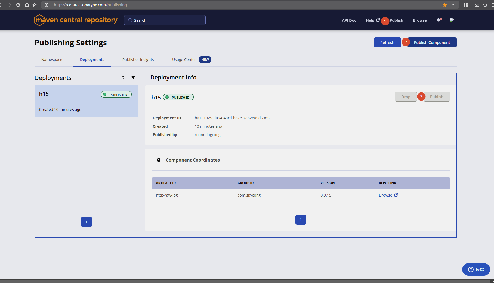
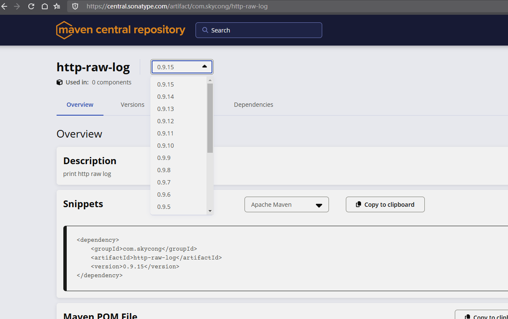

# 推送jar到Maven仓库


## 1 本地先打包



生成目标文件



将com 目录打成zip


## 2，GPG 签名配置

Maven Central 要求所有构件必须经过 GPG 签名。

### 2.1 安装 GPG

Windows 下载：https://www.gpg4win.org/

### 2.2 生成密钥（如果没有）

```bash
gpg --gen-key
```

### 2.3 查看密钥 ID

```bash
gpg --list-secret-keys --keyid-format LONG
```

输出示例：
```
sec   rsa2048/5AFD16C6882971E6 2022-03-08 [SC]
      5AFD16C6882971E6F606CF002F533D5A0XXXXXXXXX
uid                 [ultimate] ruanmc <mc@sky...>
ssb   rsa2048/XXXXXXXXXXXXXXXX 2022-03-08 [E]
```

**Key ID** 就是 `sec` 行 `rsa2048/` 后面的那串，例如 `5AFD16C6882971E6`。

### 2.4 上传公钥到密钥服务器

```bash
gpg --keyserver keyserver.ubuntu.com --send-keys 5AFD16C6882971E6
```

如果上传失败，尝试其他服务器：
```bash
gpg --keyserver keys.openpgp.org --send-keys 5AFD16C6882971E6
gpg --keyserver pgp.mit.edu --send-keys 5AFD16C6882971E6
```

### 2.5 验证公钥已上传

```bash
gpg --keyserver keyserver.ubuntu.com --search-keys 5AFD16C6882971E6
```

### 2.6 Gradle 中配置 GPG

在 `~/.gradle/gradle.properties` 中配置：

```properties
signing.keyId=5AFD16C6882971E6
signing.password=你的GPG密码
signing.secretKeyRingFile=C:/Users/rando/.gnupg/secring.gpg
```

> 注意：GPG 2.1+ 不再生成 `secring.gpg`，需要手动导出：
> ```bash
> gpg --export-secret-keys 5AFD16C6882971E6 > ~/.gnupg/secring.gpg
> ```

## 3，登录Maven网站 https://central.sonatype.com/

- 点 publish
- 点 Publish Component ，选择第一步的zip上传
- 校验完成后，点 publish




## 4，全部通过后，查看最新的版本号 https://central.sonatype.com/artifact/com.skycong/http-raw-log



